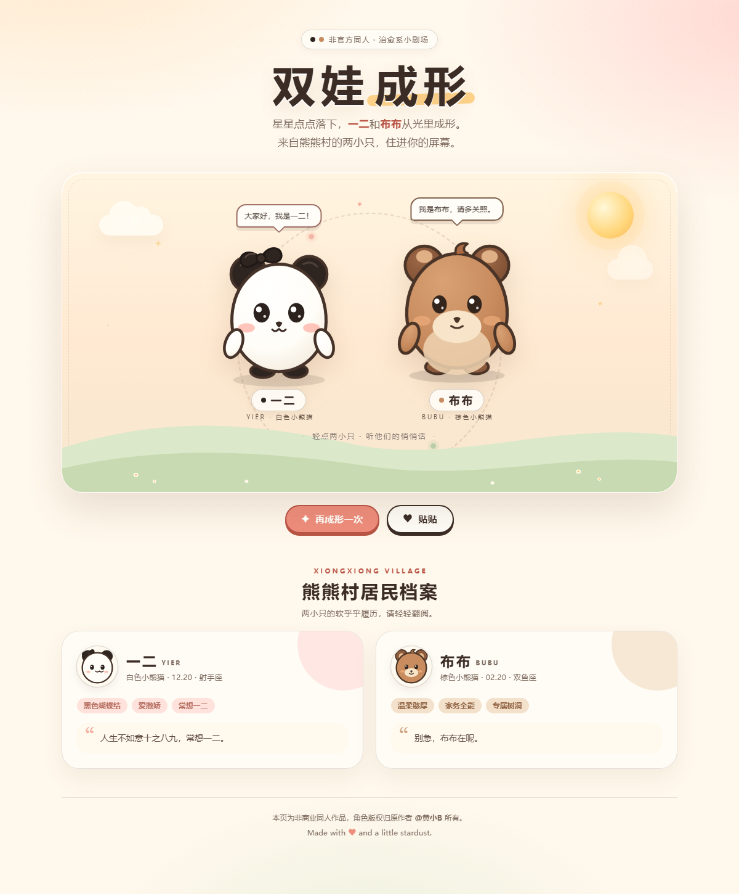

# 双娃成形 · 一二 & 布布

一个单文件、零依赖的治愈系互动小页面。星星点点落下，一二和布布从光里成形，来自熊熊村的两小只就这样住进屏幕。

**在线预览：** <https://swvx0101.github.io/shuangwa-chengxing/>



## 小剧场里有什么

- **双娃成形**：粒子从四周汇聚，两小只带着弹性一起出现；点「再成形一次」可以重播。
- **戳一戳**：轻点一二或布布，会有随机对话，另一只会自然地接话。
- **贴贴**：两小只靠近、拥抱，还会冒出一颗大心和一圈小爱心。
- **小动作**：随机眨眼、轻轻呼吸、飘动的云、闪烁的星光，以及会缓慢旋转的虚线光环。
- **响应式**：桌面和手机都能正常显示。

## 运行方式

无需安装任何依赖，直接用浏览器打开 `index.html` 即可。

也可以起一个本地静态服务器：

```bash
python -m http.server 8000
```

然后访问 <http://localhost:8000>。

## 角色档案

| 角色 | 简介 |
| --- | --- |
| **一二** | 白色小熊猫，黑色蝴蝶结，12 月 20 日出生，射手座。单纯乐观、爱撒娇，名字取自「常想一二，不思八九」。 |
| **布布** | 棕色小熊猫，2 月 20 日出生，双鱼座。温柔憨厚、耐心十足，擅长做家务和照顾一二。 |

两小只来自熊熊村，是一对治愈系情侣 IP。

## 说明

- 本仓库为**非商业同人作品**；「一二布布」角色版权归原作者 **@黄小B** 所有。
- 页面代码可自由参考与修改，如果喜欢这对小熊猫，请支持原作者的正版作品。
- 页面中的角色形象为个人风格的简化 SVG 演绎，并非官方素材。
